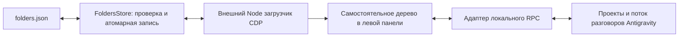

# Устройство Folders, архитектура 2

## Границы компонентов



| Файл | Ответственность |
|---|---|
| `folders-model.js` | Чистая модель дерева, сортировка, операции и проверка циклов; преобразование снимков разговоров в строки. |
| `folders-store.js` | Проверка JSON, последняя корректная версия, ревизия, уведомления при внешней замене файла. |
| `folders-manager.js` | Совместимый CLI и атомарная запись с проверкой хеша прочитанной версии. |
| `antigravity-adapter.js` | Единственный адаптер локальных RPC, JSON DTO, потока Connect и маршрутов SPA. |
| `folders-view.js` / `folders-view.css` | Свой DOM и виртуальный список; компактная геометрия, выбор, состояние, навигация. |
| `folders-client.js` | Собственные диалоги, выбор расположения, контекстные меню и drag and drop. |
| `renderer-source.js` | Сборка собственных исходников, смена версии без перезагрузки документа; подтверждение установки или отложенная установка. |
| `cdp-runtime.js` | Дескриптор Tools: исходники, стили и канал хранения. |
| `runtime-health.js` | Чтение фактического состояния всех окон через CDP. |

Файлы `folders-layout.js`, `folders-patch.js`, `folders-bootstrap.js` и преобразование AST клиента удалены из рабочего пути. Новый код не ищет минифицированные функции, переменные, React hooks или точки создания проектов.

## Внешние контракты

1. CDP: текущий порт читается из `%APPDATA%/Antigravity/DevToolsActivePort`, приложение проверяется через `/json/version`. Новые targets перечитываются; порт и ID не запоминаются как постоянные.
2. Оболочка: локальная HTTPS-страница с `window.__APP_CONFIG__.productName`, `csrfToken`, корнем приложения и nativeStorage; главный execution context. Отбор не ограничен путём `/`: страницы `/c/ID` также сохраняют канал хранилища. Iframe плагина не получает канал записи конфигурации.
3. Место дерева: один `[data-testid="conversation-list-sidebar"]` внутри `[role="navigation"]`. Только этот список скрывается после успешного чтения данных. Остальной интерфейс остаётся под управлением Antigravity.
4. Локальные RPC `/exa.language_server_pb.LanguageServerService/`: `ListProjects`, `ReadProjects`, `CreateProject`, `UpdateProject`, `JetboxSubscribeToSummaries`, `UpdateConversationAnnotations`.
5. SPA-навигация: `/c/ID?section=PROJECT_ID` для существующего разговора. Изменение маршрута не перезагружает страницу. Переименование отправляет только annotations с mergeAnnotations и точным cascadeIds; снимок траектории не перезаписывается. Прогресс, пришедший во время запроса, сохраняется.

Схемы получены из установленной 2.27.0 и проверены фактическими ответами, а не угаданы по именам компонентов. Используемые поля и методы закреплены в `antigravity-adapter.js` и регрессионных проверках; одноразовые выгрузки схем удалены. Это частный API: его удаление потребует изменения этого адаптера.

Дополнительные поля DTO допускаются и сохраняются. Перепутанные или отсутствующие ID проектов, неизвестная оболочка потока, смена кодирования и обрыв соединения дают явную ошибку. Поток учитывает `updates` и `deletes`, собирает раздробленные пакеты, переподключается с задержкой 1–30 секунд. При сбое последнее корректное состояние сохраняется. Первое корректное сообщение после переподключения начинает новый снимок.

## Хранение и несколько окон

В интерфейсе нет отдельного файлового сервера. Promise-запрос передаётся через CDP Runtime binding; процесс Tools проверяет главный execution context, канал и конверт. Для всех окон конфигурацию меняет один актор `FoldersStore`.

`POST` несёт прочитанную ревизию. Перед записью файл перечитывается и его SHA-256 сравнивается с ожидаемым. Новый JSON записывается во временный файл того же каталога, синхронизируется на диск и переименовывается. Это защищает от неполной записи и устаревших снимков; внешним писателям также следует использовать общий API или атомарную запись с проверкой ревизии. Произвольный сторонний процесс, игнорирующий этот протокол, не становится частью транзакции.

Наблюдатель каталога объединяет события за 75 ms. Новая ревизия передаётся всем окнам; дополнительное чтение раз в две секунды восстанавливает состояние после временного сбоя уведомления. Сворачивание хранится отдельно от модели и штатных настроек Antigravity.

## Геометрия и нагрузка

Дерево формирует собственный плоский список и создаёт DOM только для видимых строк с запасом. Нет перемещения строк чужого виртуального списка. Расчёт позиций и CSS используют одну переменную `--antigravity-tree-row-height`; по умолчанию 16 px. Глубина даёт 14 px на уровень. Рендер ограничен таймером, сохраняет фокус, не заменяет строку во время меню, переименования или перетаскивания.

`Intl.Collator` создаётся один раз. В браузерной проверке 5000 проектов остаются виртуализированными, обновление разговора сохраняет маршрут и несохранённый текст вне дерева. Наблюдатель действий ограничен собственным корнем; повторная запись неизменившегося сообщения об ошибке не создаёт бесконечную цепочку MutationObserver.

## Проверки

Из `Upgrade/code`:

```powershell
npm test
npm run test:browser
node upgrade.js --check
```

Тесты проверяют поведение модели, конкурентную запись, потерянный ответ CreateProject, поток разговоров, новые окна, смену порта и документа, закрытие окна во время подключения, отсутствие точки монтирования и задержанную загрузку штатного UI. Браузерные тесты используют отдельный headless Edge, вымышленные данные и перехваченные запросы; они не открывают тестовые окна Antigravity и не меняют пользовательские проекты.
